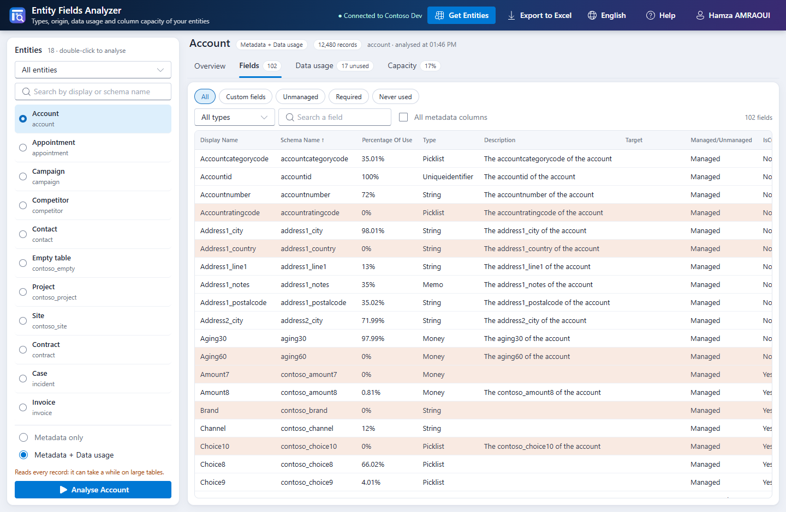
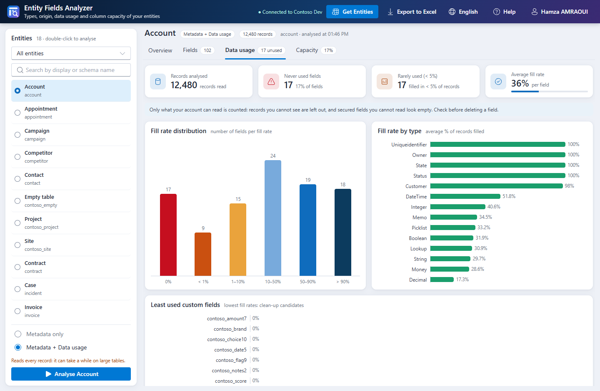
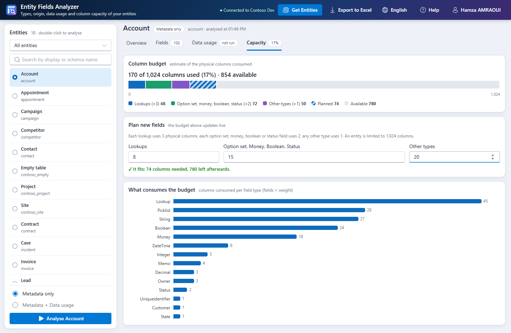

# Entity Fields Analyzer

**A Power Platform ToolBox tool that shows what is really inside a Dataverse table.**

*Reads the fields. Measures what is filled. Estimates the room left. Recommends what to clean up. Never writes to Dataverse.*

[](https://www.npmjs.com/package/pptb-entity-fields-analyzer)
[](https://www.powerplatformtoolbox.com/)
[](https://www.xrmtoolbox.com/plugins/EntityFieldsAnalyser/)
[](https://github.com/AmraouiH/EntityFieldsAnalyzer-PPTB/blob/main/LICENSE)
[](https://learn.microsoft.com/power-apps/developer/data-platform/)
[](#what-this-tool-changes)

> **From XrmToolBox to Power Platform ToolBox.** This tool comes from [**Entity Fields Analyser**](https://www.xrmtoolbox.com/plugins/EntityFieldsAnalyser/), the XrmToolBox plugin by Hamza AMRAOUI with more than 50,000 downloads. It is ported by the same author.


---

## What it does

You pick a table. It gives you a clear picture of its fields, and an Excel report of what it found.

| | |
|---|---|
| 🔍 **Explains the table** | Field types, standard or custom, managed or unmanaged, publisher prefixes, settings, fields created over time. |
| 📋 **Lists every field** | Metadata, quick filters, type filter, search and sort. 32 more columns with *All metadata columns*. |
| 🧪 **Measures real usage** | Fill rate of each field across the records you can read: never used, rarely used (under 5%), least used custom fields. |
| 📐 **Plans capacity** | Estimate of the physical columns used out of 1,024, and a calculator for the fields you want to add. |
| 💡 **Recommends** | Findings sorted by severity in the Excel report: clean-up, data quality, documentation, ALM, security. |
| 📊 **Reports in Excel** | One workbook with a dashboard, native charts and up to 9 sheets. |
| 🌍 **Feels at home** | English and French, light and dark theme. |

---

## How it differs from other ToolBox tools

Some listed tools also read field metadata or values. Entity Fields Analyzer is about the **health of one table**: how full every field is, how many of the 1,024 columns are used, and what to clean up.

| Tool | What it is for | What Entity Fields Analyzer adds |
|---|---|---|
| **Entity Field Catalog** | Exports the field metadata of several tables of a solution to Excel or CSV | Fill rates, capacity estimate and calculator, interactive charts, clean-up recommendations |
| **Metadata Browser** | Browses metadata and compares it across environments | Fill rates from the records, capacity planning, a report that analyses the table |
| **Data Validation** | Runs the tests you configure on columns, including whether they contain data | Fill rate of every field with no setup, combined with origin, capacity and recommendations |
| **Field Reference Finder** | Finds the components that reference a field | It is the step before: which fields are worth checking. Use Field Reference Finder before deleting one |

For documentation of many tables, comparison between environments or dependency search, use those tools.

---

## How an analysis runs

```
 Get Entities ──► Pick a table ──► Choose a mode ──► Analyse
                                                        │
 Excel report ◄── Export ◄── Drill down ◄── Charts and figures
```

| Step | What happens | Your role |
|---|---|---|
| **1. Load** | Lists the tables of the connected environment | **Click Get Entities** |
| **2. Choose** | Filters and searches by display or schema name | **Pick a table and a mode** |
| **3. Analyse** | Reads the metadata, and the records if you asked for data usage | **Click Analyse** |
| **4. Explore** | Every chart and tile opens the matching fields, already filtered | Click what interests you |
| **5. Report** | Builds the Excel workbook on your computer | **Click Export to Excel** |

> **Nothing is read until you click, and nothing is ever written to Dataverse.** Stop or Esc interrupts an analysis.

---

## Quick start

**1. Open the tool**

In [Power Platform ToolBox](https://www.powerplatformtoolbox.com/), open **Entity Fields Analyzer** and pick a Dataverse connection. To run it from the source code, see [Run from source](#run-from-source).

**2. Load your tables**

Click **Get Entities**, then select a table.

**3. Pick a mode and analyse**

| Mode | What it reads | When to use it |
|---|---|---|
| **Metadata only** | The definition of the fields | A fast look at the structure and the capacity |
| **Metadata + Data usage** | The definition, plus every record you can read | Before a clean-up. Slower on large tables |

**4. Export**

Click **Export to Excel** to save and share the report.

---

## A closer look

### Fields

Every field with its metadata. The fields that are empty in every record are highlighted.



### Data usage

How full each field is, and where to start the clean-up.



### Capacity

What consumes the columns, and whether the fields you plan to add will fit.



### Dark theme

The tool follows the theme of the ToolBox.


*Screenshots use demo data.*

---

## What is in the Excel report

| Sheet | Content |
|---|---|
| **Metadata** | Every analysed field with its properties, in a sheet named after the table |
| **Dashboard** | Key figures and native Excel charts |
| **Summary** | The figures of the analysis and the number of findings |
| **Recommendations** | Each finding with its severity and what to do |
| **Data usage** | Fill rate per field, only in *Metadata + Data usage* mode |
| **By Type** | Breakdown per field type |
| **By Publisher** | Breakdown per publisher prefix |
| **Lookups** | Lookup fields and the tables they target |
| **Timeline** | Fields created over time |

---

## How the figures are computed

- **Analysed fields**: readable attributes, without virtual, party list, composite and companion attributes (`AttributeOf`).
- **Fill rate**: share of the records read where the field has a value. `0`, `No` and an empty text count as values.
- **Column capacity**: an estimate with the weights below, against 1,024 columns.

| Field type | Columns |
|---|---|
| Lookup, Owner | 3 |
| Option set, Money, Boolean, Status | 2 |
| Any other type | 1 |

Background: [Field limits in Dynamics 365: how many fields is too many fields?](https://hamzaamraoui.medium.com/field-limits-in-dynamics-365-how-many-fields-is-too-many-fields-ab39c699336e)

---

## What this tool changes

**Nothing in Dataverse.** The tool never creates, updates, deletes or publishes anything.

On your computer, it writes the Excel report when you export it, and three preferences in the ToolBox settings: language, entity filter and metadata columns.

---

## Safety

- Only read requests, sent to the connected environment through the ToolBox.
- No external host, no telemetry.
- Records are read in memory, page by page. Only a counter per field is kept: no record value is stored or exported.
- A stopped analysis keeps no partial result.
- A secured field that reads as empty is never proposed for deletion.

Always check forms, views, processes, plugins and integrations before deleting a field. You remain responsible for what you delete.

---

## Limitations

- **Not analysed**: multi-select choices, files and images, which are virtual attributes.
- **Permissions**: records you cannot read are not counted, and secured fields you cannot read look empty. Check with a privileged account before a clean-up.
- **Large tables**: data usage reads every record, so it takes time and counts toward the Dataverse service protection limits. Pages shrink automatically to stay under the 16 MB response limit of the ToolBox.
- **Unpublished changes**: included when Dataverse accepts `RetrieveEntity`. Otherwise the tool reads the published metadata and tells you.

---

## Run from source

| Requirement | Why |
|---|---|
| Power Platform ToolBox | runs the tool |
| Node.js 20.19+ | build and tests |
| Edge or Chrome | end-to-end tests |

```bash
git clone https://github.com/AmraouiH/EntityFieldsAnalyzer-PPTB.git
cd EntityFieldsAnalyzer-PPTB
npm install
npm run build
```

Then, in Power Platform ToolBox:

1. Open **Settings**, turn on **Show Debug Menu** and select **Save**.
2. In **Debug**, under **Load Local Tool**, select **Browse** and pick the folder that contains `package.json`.
3. Select **Load Tool**.

| Command | Purpose |
|---|---|
| `npm run build` | Type-check and build into `dist/` |
| `npm run dev-watch` | Development build, rebuilt on save |
| `npm run validate` | Marketplace validation of the package |
| `npm run test:logic` | Tests of the calculations, paging and Excel report |
| `npm run test:e2e` | Browser tests against a simulated Dataverse and ToolBox |

---

## AI Assistance

A substantial part of the code, the tests and this documentation was written with an AI coding assistant (Claude Code, by Anthropic). See the [AI-Assisted Development policy](https://docs.powerplatformtoolbox.com/policies/ai-assisted-development).

---

## Credits

Entity Fields Analyzer is a port of [**Entity Fields Analyser** for XrmToolBox](https://www.xrmtoolbox.com/plugins/EntityFieldsAnalyser/) by [Hamza AMRAOUI](https://www.linkedin.com/in/hamza-amraoui/) ([source code](https://github.com/AmraouiH/Entity-Field-Analyser)).

The original repository has no license file. Its author publishes this port under the MIT license.

---

## Support

If the tool helps you, you can support its development on [PayPal](https://www.paypal.com/paypalme/EntityFieldsAnalyser). Bugs and ideas are welcome in [GitHub issues](https://github.com/AmraouiH/EntityFieldsAnalyzer-PPTB/issues).

---

## License

[MIT](https://github.com/AmraouiH/EntityFieldsAnalyzer-PPTB/blob/main/LICENSE) © 2026 Hamza AMRAOUI

**[XrmToolBox version](https://www.xrmtoolbox.com/plugins/EntityFieldsAnalyser/)** · **[Source](https://github.com/AmraouiH/EntityFieldsAnalyzer-PPTB)** · **[Issues](https://github.com/AmraouiH/EntityFieldsAnalyzer-PPTB/issues)** · **[LinkedIn](https://www.linkedin.com/in/hamza-amraoui/)**
