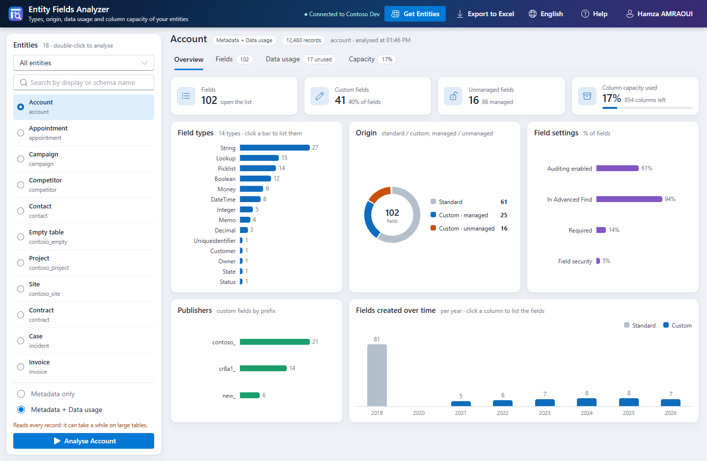
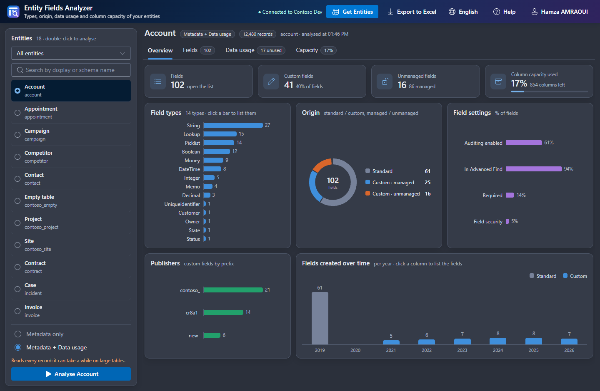

# Entity Fields Analyzer (Power Platform ToolBox)

Entity Fields Analyzer for [Power Platform ToolBox](https://www.powerplatformtoolbox.com/) is the web version of the Entity Fields Analyser XrmToolBox plugin. It answers four questions about a Dataverse / Dynamics 365 table:

- What are its fields, and where do they come from?
- Which fields are really filled, and which are never used?
- How much room is left before the limit of 1,024 columns?
- What should be cleaned up first?

| Page | What it does |
|---|---|
| **Overview** | Key figures, field types, origin (standard / custom, managed / unmanaged), field settings, custom fields per publisher prefix, fields created over time. Click a chart or a tile to list its fields. |
| **Fields** | Every field with its metadata (32 more columns with *All metadata columns*), quick filters, type filter, search, sort. |
| **Data usage** | Fill rate of each field, never used and rarely used fields, distribution, fill rate by type, least used custom fields. |
| **Capacity** | Estimate of the physical columns used, what consumes them, and a calculator for the fields you plan to add. |
| **Export to Excel** | One workbook: metadata, dashboard with native charts, summary, recommendations, data usage, by type, by publisher, lookups, timeline. |

Nothing is read until you click **Get Entities**. The interface and the report are available in English and French.

## Screenshots

Demo data from the end-to-end tests.

**Overview**: every chart opens the matching fields.



**Fields**: the fields empty in every record are highlighted.


**Data usage**: the clean-up candidates.


**Capacity**: plan new fields before creating them.


**Dark theme**: the tool follows the theme of the ToolBox.



## How to use

1. Open the tool with a Dataverse connection and click **Get Entities**.
2. Filter or search the list, then click an entity (a double-click analyses it right away).
3. Choose **Metadata only**, or **Metadata + Data usage** to also measure how full each field is.
4. Click **Analyse**. **Stop** or **Esc** interrupts an analysis; no partial result is kept.
5. Click **Export to Excel** to save the report.

## What this tool changes

**Nothing in Dataverse.** The tool only sends read requests: it never creates, updates, deletes or publishes anything.

On your computer, it writes the Excel report when you export it, and three preferences in the ToolBox settings (language, entity filter, metadata columns).

## Data and network

- The tool calls only the connected Dataverse environment, through the ToolBox. It declares no external host and sends no telemetry.
- Data usage reads the records of the table in memory, page by page, and keeps only a counter per field. No record value is stored or exported.

## How the figures are computed

- **Analysed fields**: readable attributes, without virtual, party list, composite and companion attributes (`AttributeOf`). Multi-select choices, files and images are virtual attributes, so they are not analysed.
- **Fill rate**: share of the records read where the field has a value. `0`, `No` and an empty text are values.
- **Column capacity** is an estimate with the weights below, against 1,024 columns.

| Field type | Columns |
|---|---|
| Lookup, Owner | 3 |
| Option set, Money, Boolean, Status | 2 |
| Any other type | 1 |

Background: [Field limits in Dynamics 365: how many fields is too many fields?](https://hamzaamraoui.medium.com/field-limits-in-dynamics-365-how-many-fields-is-too-many-fields-ab39c699336e)

## Known limitations

- **Permissions**: only what your account can read is counted. Records you cannot see are left out, and secured fields you cannot read look empty. Check with a privileged account before deleting a field.
- **Large tables**: data usage reads every record, so it can take a long time and it counts toward the service protection limits of Dataverse. The ToolBox rejects responses over 16 MB, so pages are sized to the records and the scan restarts with smaller pages when one is still too large.
- **Unpublished changes** are included when Dataverse accepts `RetrieveEntity`. Otherwise the tool reads the published metadata and says so.

## Build

Requirements: Node.js 20.19 or later.

```bash
npm install
npm run build        # type-check + vite build -> dist/
npm run dev-watch    # development build with source maps, rebuilt on save
npm run validate     # pptb-validate
```

## Automated tests

```bash
npm run test:logic   # metadata, paging, capacity, recommendations, Excel
npm run test:e2e     # headless Edge / Chrome against an in-memory Dataverse and ToolBox
```

The end-to-end tests open the production bundle with a content security policy like the one of the ToolBox. They fail on any write, extra header or console error. Set `EFA_SHOTS` and `EFA_XLSX` to folders to keep the screenshots and workbooks, and `PW_BROWSER` if your browser is not in a standard location.

## Load in Power Platform ToolBox

1. Run `npm run build`.
2. In Power Platform ToolBox, open **Settings**, turn on **Show Debug Menu**, and select **Save**.
3. In the **Debug** section, under **Load Local Tool**, select **Browse**, pick this folder (the one that contains `package.json`), then select **Load Tool**.
4. Open **Entity Fields Analyzer** and pick a connection.

## Publish

1. Update `version` in `package.json`.
2. Run `npm run build`, `npm run validate`, then `npm run finalize-package`.
3. Run `npm publish --access public`.
4. Submit the package at https://www.powerplatformtoolbox.com/submit-tool.

## AI Assistance

A substantial part of the code, the tests and this documentation was written with an AI coding assistant (Claude Code, by Anthropic).
See the [AI-Assisted Development policy](https://docs.powerplatformtoolbox.com/policies/ai-assisted-development).

## Credits

Port of the [Entity Fields Analyser XrmToolBox plugin](https://github.com/AmraouiH/Entity-Field-Analyser) by Hamza AMRAOUI, republished here by its author under the MIT license.

## Support

If the tool helps you, you can support its development on [PayPal](https://www.paypal.com/paypalme/EntityFieldsAnalyser). Bugs and ideas: [GitHub issues](https://github.com/AmraouiH/EntityFieldsAnalyzer-PPTB/issues).

## License

MIT
